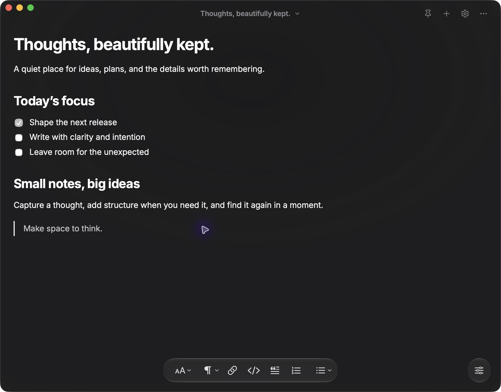
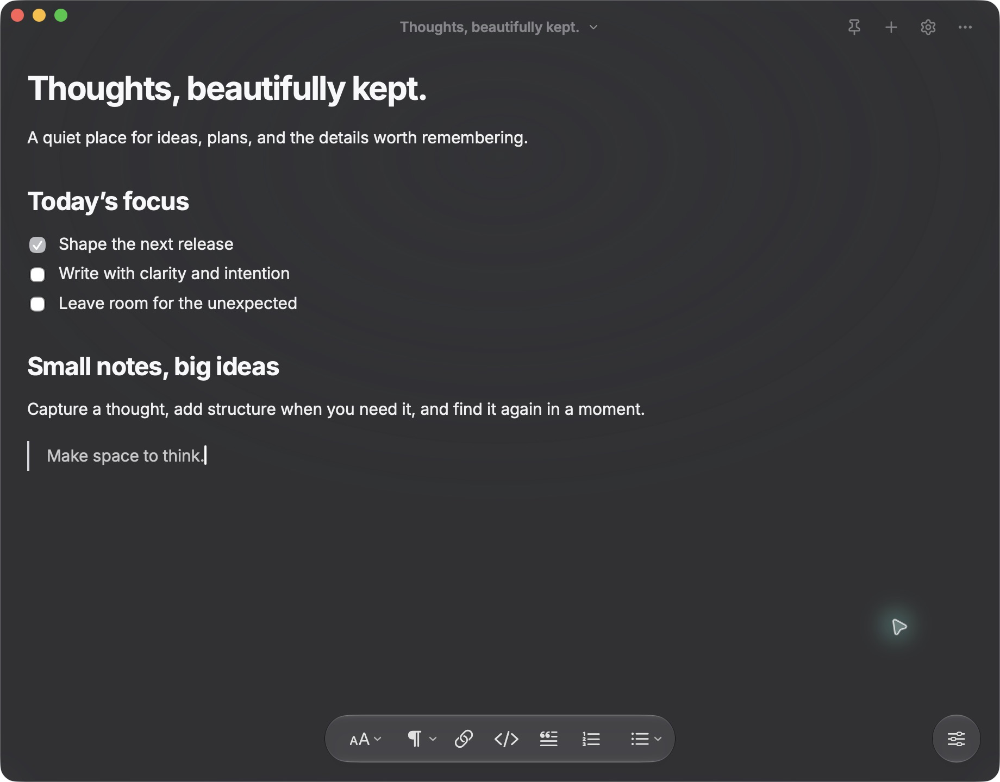
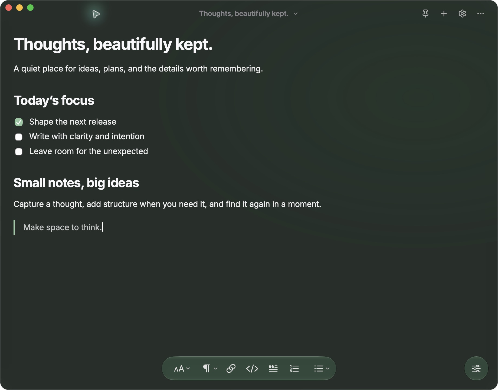
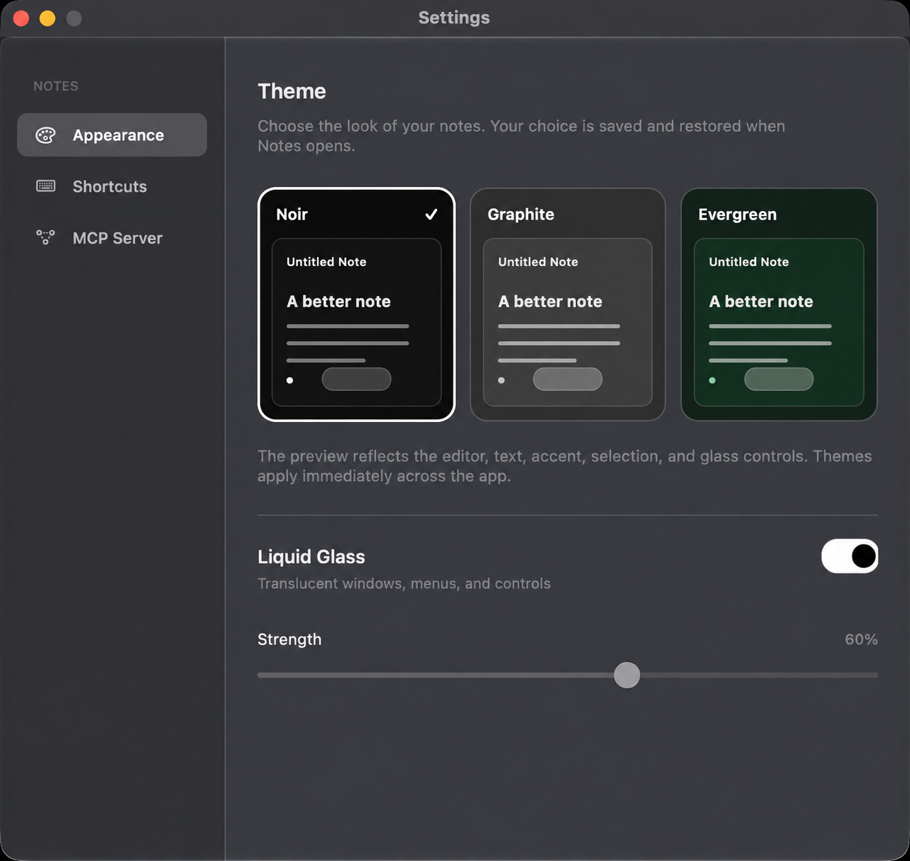

# Notes

An open source, local-first notes app for macOS. Write in a focused editor, organize with lightweight formatting, and find anything with the keyboard. Built independently for focused writing and quick capture.

[Download the developer preview](https://github.com/ubeytd/notes/releases/tag/v1.0.5) · [Release process](RELEASING.md)



## Themes

<p align="center">
  
  
  
</p>



Notes are saved locally at `~/Library/Application Support/Notes/notes.json`. The app does not require an account. Existing data in the former `NotesRebuild` folder is copied on first use.

## Run

```sh
./scripts/build-app.sh
open dist/Notes.app
```

You can also open `dist/Notes.app` in Finder after building.

## Installable release

```sh
./scripts/build-dmg.sh
```

This builds a universal Intel and Apple Silicon app, creates its icon, ad hoc signs the bundle, and writes `dist/Notes-1.0.5-universal.dmg` plus a SHA-256 checksum. Open the DMG and drag **Notes.app** to **Applications**. The bundle supports macOS 13 or newer.

When replacing an older build, your notes remain in the same local data file. Theme, glass, and custom shortcut preferences may need to be set again once because the app identifier and preference keys changed.

For public distribution, sign and notarize with your own Apple Developer ID credentials:

```sh
NOTES_SIGN_IDENTITY="Developer ID Application: Your Name (TEAMID)" \
NOTES_NOTARY_PROFILE="your-notarytool-keychain-profile" \
./scripts/build-dmg.sh
```

Create the `notarytool` keychain profile before using the second command. Without Developer ID signing and notarization, macOS Gatekeeper may block the downloaded DMG or app. The current local build is ad hoc signed because no Developer ID identity is installed on this Mac.

## Use

- `⌘N` creates a note, `⌘O` browses notes, and `⌘K` opens actions.
- `⌃⌥N` creates a note from anywhere, and `⌃⌥O` opens Browse Notes from anywhere. Change or disable these app-wide shortcuts in **Settings → Shortcuts**. They register as macOS hotkeys without Accessibility or Input Monitoring permission.
- A first-run welcome window explains local storage, shortcuts, and permissions. Open **Notes → Welcome to Notes** to see it again.
- `⌘,` opens native Settings. Appearance offers preview cards for Noir (the black and white default), Graphite, and Evergreen. The chosen theme controls accents, selection, and glass tint. The Liquid Glass switch and strength slider adjust the note window's transparency and blur, along with its menus and controls. These choices persist across launches. Shortcuts lets you record new combinations; conflicts are rejected, and Reset Defaults restores the original keys.
- Type `/` at the start of a block for a searchable formatting menu. Use arrow keys and Return to insert headings, lists, quotes, dividers, inline code, or code blocks. Use **Rename Note** in Actions, or right click a note in Browse Notes. A renamed title stays independent of the body; without a custom name, the first H1 is used as the note title.
- Type `# ` through `###### ` at the start of a line to create a heading. Press Return in a heading to continue in a normal paragraph.
- Browse Notes, Actions, and Settings open without selecting a search field. Start typing to search, use arrow keys and Return to navigate launchers, or press Escape to close them. Typing on the note canvas begins editing.
- Common formatting keys include `⌘B` for bold, `⌘I` for italic, `⌘U` for underline, `⌘⌥1` through `⌘⌥3` for headings, and `⌘⇧8` for a bulleted list. Press `⌘,` or click the Settings button to open a separate native macOS window where you can search and change shortcuts.
- Pasting Markdown renders headings, emphasis, links, fenced code blocks, tables, task lists, quotes, and other CommonMark and GFM syntax. Rich HTML paste keeps its formatting. Copy and export as Markdown preserve these structures.
- For notes pasted before this update, choose **Render Existing Markdown** from `⌘K` to format their raw Markdown text.
- The floating toolbar formats text. Its bottom right button toggles it. The empty space in the title bar drags the window.
- Standard macOS Select All, Cut, Copy, Paste, Undo, and Redo work in the editor.
- Deleted notes can be restored from Recently Deleted.
- In a code block, press Enter twice at the end to continue in a normal paragraph. Enter in an empty code block or Backspace in an empty code block also exits it.

## MCP server

Open **Settings → MCP Server**, choose your agent, and copy the configuration shown there. The app includes a local stdio MCP server in `Notes.app/Contents/Resources/notes_mcp_server.py`. It uses only Python's standard library and offers `list_notes`, `search_notes`, `get_note`, `create_note`, `update_note`, `delete_note`, and `restore_note`.

The native Settings window provides ready-to-copy entries for Codex (`~/.codex/config.toml`), Claude Desktop (`~/Library/Application Support/Claude/claude_desktop_config.json`), Claude Code (project `.mcp.json`), Cursor (`~/.cursor/mcp.json`), VS Code (`.vscode/mcp.json`), and other MCP clients. Add the entry to the agent's existing configuration, then restart or reload the agent. Install or move `Notes.app` to its intended location first because the configuration contains its absolute path.

The app and server share `~/Library/Application Support/Notes/notes.json`. Existing notes from the former data folder are copied on first use, and the app checks for external changes while running. The MCP server uses stdio, so each agent starts its own process and no network port is opened. For an isolated data file, set `NOTES_DATA_FILE` in the server process environment.

The app does not include account sync or image attachments.

## Source layout

- `Sources/Notes/main.swift`: native windows, menus, persistence, and the WebKit bridge.
- `Sources/Notes/SettingsWindow.swift`: native Settings window.
- `Sources/Notes/Web/`: editor interface, styles, and bundled frontend libraries.
- `mcp/notes_server.py`: local stdio MCP server.
- `scripts/`: universal app and DMG build scripts.

## Contributing

See [CONTRIBUTING.md](CONTRIBUTING.md). This project is licensed under [MIT](LICENSE).

## Quality checks

```sh
node --check Sources/Notes/Web/app.js
python3 -m unittest discover -s tests -v
swift tests/test_editor_headings.swift Sources/Notes/Web/index.html
codesign --verify --deep --strict dist/Notes.app
hdiutil verify dist/Notes-1.0.5-universal.dmg
```


Toolbar icons use macOS SF Symbols. Other interface icons are from Lucide under the included [Lucide license](Sources/Notes/Web/icons/LUCIDE_LICENSE). Markdown parsing uses Marked, HTML sanitizing uses DOMPurify, and Markdown export uses Turndown with its GFM plugin. Their licenses are included in [vendor](Sources/Notes/Web/vendor).
